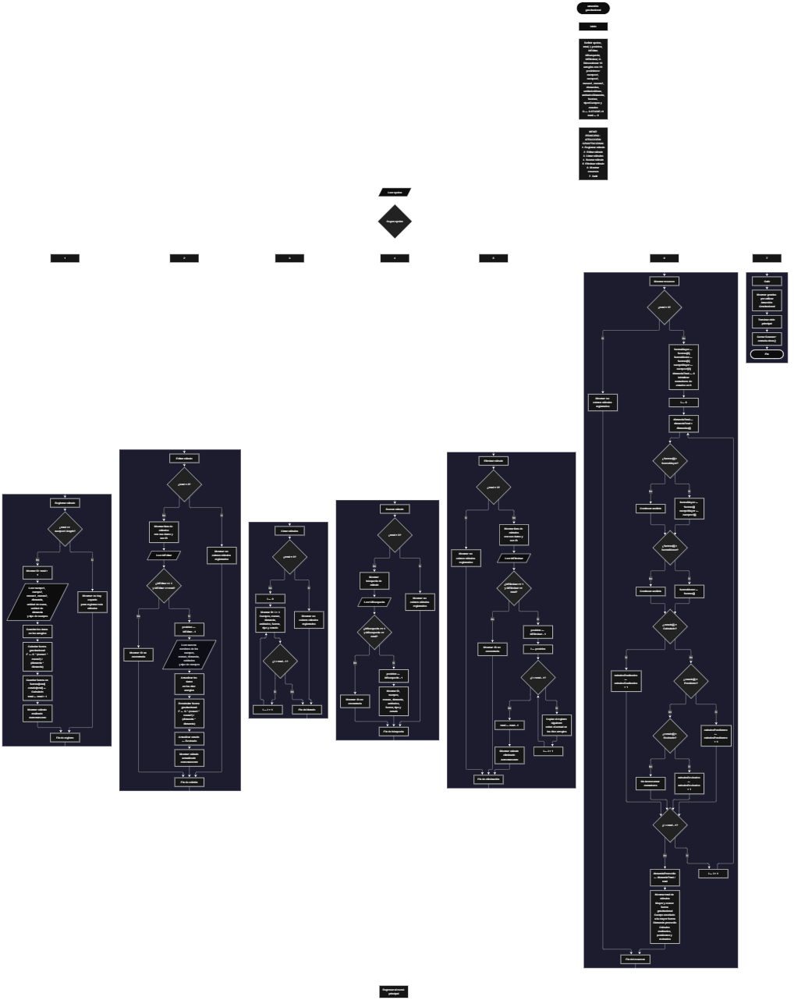

Este proyecto, llamado <b>atracción gravitacional</b>, fue desarrollado en <b>java</b> como un ejercicio práctico para fortalecer la lógica de programación mediante la creación de un sistema de gestión y cálculo de fuerzas gravitacionales desde la consola. El programa cuenta con un menú principal de siete opciones que permite <b>registrar, editar, listar, buscar, eliminar y consultar resúmenes estadísticos</b> de los cálculos realizados. Cada registro almacena información sobre dos cuerpos, sus masas, la distancia entre ellos, las unidades utilizadas, el tipo de cuerpos, la fuerza gravitacional calculada y el estado del cálculo. Para administrar esta información se utilizan arreglos paralelos con una capacidad máxima de <b>10 cálculos durante la ejecución</b>. Además, se aplica la ley de gravitación universal de Newton mediante la constante gravitacional <b>G = 6.67430E-11</b>. Durante su desarrollo se utilizaron conceptos fundamentales de programación, como variables, arreglos, estructuras condicionales, ciclos repetitivos, estructuras de selección y operaciones para buscar, modificar, eliminar y organizar registros. Este proyecto permite poner en práctica los conocimientos adquiridos en java y comprender cómo aplicar operaciones matemáticas y estadísticas dentro de un sistema de gestión.

<h2 align="center">⚙️ Funcionamiento del menú principal</h2>

### ➕ Registrar cálculo

La opción <b>1) registrar cálculo</b> permite almacenar un nuevo cálculo de atracción gravitacional. Antes de realizar el registro, el sistema comprueba que la cantidad de cálculos almacenados sea menor que la capacidad del arreglo <b>cuerpos1.length</b>, que corresponde a <b>10 registros</b>. Si existe espacio disponible, muestra el identificador del nuevo cálculo mediante <b>total + 1</b> y solicita el <b>nombre del primer cuerpo, nombre del segundo cuerpo, masa del primer cuerpo, masa del segundo cuerpo, distancia entre los cuerpos, unidad de masa, unidad de distancia y tipo de cuerpos</b>. Los datos se almacenan en las posiciones correspondientes de sus respectivos arreglos. Después, calcula la fuerza gravitacional utilizando la constante <b>G</b> y la fórmula <b>F = G * (m1 * m2) / (d * d)</b>. El resultado se almacena en el arreglo <b>fuerzas</b> y se asigna el estado <b>"Calculado"</b> en el arreglo <b>estados</b>. Finalmente, aumenta la variable <b>total</b> en uno y muestra el mensaje <b>"cálculo realizado correctamente."</b>. Si se alcanza la capacidad máxima, presenta el mensaje <b>"no hay espacio para registrar más cálculos."</b>, impidiendo agregar otro registro.

### ✏️ Editar cálculo

La opción <b>2) editar cálculo</b> permite modificar la información de un cálculo gravitacional registrado. Primero, el programa comprueba si existen cálculos almacenados mediante la variable <b>total</b>. Si no hay registros, muestra el mensaje <b>"no existen cálculos registrados."</b>. En caso contrario, presenta una lista con el identificador, los nombres de los cuerpos, las masas, la distancia, las unidades, la fuerza gravitacional, el tipo de cuerpos y el estado de cada cálculo. Después, solicita el ID del cálculo que se desea editar y comprueba que esté dentro del rango permitido mediante la condición <b>idEditar &gt;= 1 &amp;&amp; idEditar &lt;= total</b>. Si la selección es válida, obtiene la posición correspondiente mediante <b>idEditar - 1</b> y solicita los nuevos datos de los dos cuerpos, sus masas, la distancia, las unidades y el tipo de cuerpos. Los arreglos se actualizan directamente en la posición seleccionada. Posteriormente, vuelve a calcular la fuerza gravitacional con los nuevos valores y cambia el estado del registro a <b>"Revisado"</b>. Finalmente, presenta el mensaje <b>"cálculo actualizado correctamente."</b>. Si el ID introducido no corresponde a un cálculo registrado, muestra el mensaje <b>"ID no encontrada."</b>.

### 🗑️ Eliminar cálculo

La opción <b>5) eliminar cálculo</b> permite eliminar un cálculo gravitacional mediante su identificador dentro de la lista. Antes de comenzar, el programa comprueba que existan cálculos almacenados. Si no hay registros, muestra el mensaje <b>"no existen cálculos registrados."</b>. Si existen cálculos disponibles, presenta una lista con toda la información de cada registro. Después, solicita el ID del cálculo que se desea eliminar y verifica que se encuentre dentro del rango válido. Si el cálculo existe, obtiene su posición mediante <b>idEliminar - 1</b> y comienza el proceso de eliminación. Para mantener los registros organizados, utiliza un ciclo <b>for</b> controlado por la variable <b>i</b>, que desplaza una posición hacia atrás los datos de los cálculos posteriores en los diez arreglos: <b>cuerpos1, cuerpos2, masas1, masas2, distancias, unidadesMasa, unidadesDistancia, fuerzas, tiposCuerpos y estados</b>. Posteriormente, disminuye la variable <b>total</b> en uno y muestra el mensaje <b>"cálculo eliminado correctamente."</b>. Si el ID seleccionado no corresponde a un cálculo registrado, presenta el mensaje <b>"ID no encontrada."</b>.

### 🔎 Buscar cálculo

La opción <b>4) buscar cálculo</b> permite localizar un cálculo gravitacional mediante su ID. Primero, el programa comprueba si existen cálculos registrados. Si no hay registros, muestra el mensaje <b>"no existen cálculos registrados."</b>. En caso contrario, solicita el identificador del cálculo que se desea buscar y comprueba que esté dentro del rango permitido mediante la condición <b>idBusqueda &gt;= 1 &amp;&amp; idBusqueda &lt;= total</b>. Si el ID es válido, obtiene la posición correspondiente mediante <b>idBusqueda - 1</b> y muestra la información completa del cálculo: nombres de los cuerpos, masas, distancia, unidades, fuerza gravitacional, tipo de cuerpos y estado. Si el identificador introducido no corresponde a ningún registro existente, presenta el mensaje <b>"ID no encontrada."</b>. Esta función permite consultar directamente un cálculo sin necesidad de recorrer manualmente toda la lista.

### 📋 Listar cálculos

La opción <b>3) listar cálculos</b> permite visualizar todos los cálculos gravitacionales registrados actualmente. Antes de mostrar la información, el programa comprueba si la variable <b>total</b> es igual a cero. Si no existen registros, presenta el mensaje <b>"no existen cálculos registrados."</b>. Si hay cálculos disponibles, utiliza un ciclo <b>for</b> para recorrer los arreglos desde la primera posición hasta la cantidad total de registros almacenados. Durante el recorrido, muestra el identificador, los nombres de los cuerpos, las masas, la distancia, las unidades de masa y distancia, la fuerza gravitacional, el tipo de cuerpos y el estado de cada cálculo. Esta función facilita consultar todos los resultados almacenados sin necesidad de buscar cada cálculo individualmente.

### 📊 Mostrar resumen

La opción <b>6) mostrar resumen</b> permite consultar un análisis estadístico de los cálculos gravitacionales registrados. Primero, el programa comprueba si existen registros almacenados. Si no hay cálculos, muestra el mensaje <b>"no existen cálculos registrados."</b>. En caso contrario, inicializa las variables <b>fuerzaMayor</b> y <b>fuerzaMenor</b> con el primer valor del arreglo <b>fuerzas</b>, establece <b>distanciaTotal</b> en cero y guarda el primer cuerpo del primer registro en <b>cuerpoMayor</b>. También inicializa los contadores <b>calculosRealizados, calculosPendientes y calculosRevisados</b> en cero. Después, utiliza un ciclo <b>for</b> para recorrer los cálculos y acumular las distancias, identificar la mayor y menor fuerza gravitacional y determinar el primer cuerpo asociado a la mayor fuerza. Durante el mismo recorrido, clasifica los registros según sus estados mediante comparaciones con <b>equalsIgnoreCase()</b>. Finalmente, calcula la distancia promedio dividiendo <b>distanciaTotal</b> entre <b>total</b> y presenta el número de cálculos registrados, la mayor fuerza, la menor fuerza, el cuerpo asociado a la mayor fuerza, la distancia promedio y la cantidad de cálculos realizados, pendientes y revisados.

### 🚪 Salir del menú principal

La opción <b>7) salir</b> está destinada a finalizar la ejecución del programa y muestra el mensaje <b>"gracias por utilizar Atracción Gravitacional."</b>. El menú principal se encuentra dentro de una estructura repetitiva <b>do-while</b>, que mantiene el programa en funcionamiento mientras la opción seleccionada sea diferente de <b>7</b>. Cuando el usuario selecciona esta opción, la condición del ciclo deja de cumplirse, finaliza la repetición y se ejecuta la instrucción <b>entrada.close()</b>, que cierra el objeto <b>Scanner</b> utilizado para la entrada de datos.

<h2 align="center">🧠 Temas aplicados en el proyecto</h2>

### 📦 Variables

En este proyecto se utilizan variables para almacenar la opción seleccionada en el menú, controlar la cantidad de cálculos registrados, identificar las posiciones de los arreglos, guardar los identificadores seleccionados y realizar operaciones matemáticas y estadísticas. También se utilizan variables auxiliares para determinar las fuerzas gravitacionales mayor y menor, acumular las distancias y contabilizar los diferentes estados de los cálculos. Cada variable cumple una función específica dentro de las operaciones del sistema.

🔢 **Opcion:** Almacena la opción seleccionada por el usuario en el menú principal.

📊 **Total:** Controla la cantidad actual de cálculos gravitacionales registrados.

🔄 **I:** Funciona como contador en los ciclos `for` y permite recorrer los arreglos, mostrar los registros y desplazar los datos durante la eliminación.

📍 **Posicion:** Almacena el índice correspondiente al cálculo seleccionado mediante su ID.

🔎 **IdEditar, IdBusqueda e IdEliminar:** Almacenan los identificadores introducidos por el usuario para editar, buscar y eliminar cálculos, respectivamente.

🌌 **G:** Constante de gravitación universal con el valor <b>6.67430E-11</b>.

💪 **FuerzaMayor y FuerzaMenor:** Almacenan los valores máximo y mínimo de fuerza gravitacional encontrados durante el resumen.

🌍 **CuerpoMayor:** Almacena el nombre del primer cuerpo asociado al cálculo que presenta la mayor fuerza gravitacional.

📏 **DistanciaTotal:** Acumula las distancias de todos los cálculos registrados para obtener el promedio.

📐 **DistanciaPromedio:** Almacena el resultado de dividir la distancia acumulada entre la cantidad total de cálculos.

📈 **CalculosRealizados, CalculosPendientes y CalculosRevisados:** Contabilizan los cálculos según el estado almacenado en el arreglo `estados`.

### 🗃️ Arreglos

En este proyecto se utilizan diez arreglos paralelos relacionados con la información de cada cálculo gravitacional. Cada arreglo tiene una capacidad de <b>10 posiciones</b> y utiliza el mismo índice para representar los datos correspondientes a un mismo registro. Por ejemplo, la información de un cálculo almacenado en la posición <b>0</b> se encuentra distribuida entre <b>cuerpos1[0], cuerpos2[0], masas1[0], masas2[0], distancias[0], unidadesMasa[0], unidadesDistancia[0], fuerzas[0], tiposCuerpos[0] y estados[0]</b>. Esta organización permite recorrer, buscar, modificar, mostrar y eliminar los cálculos de manera ordenada.

🌌 **Cuerpos1[10]:** Almacena los nombres del primer cuerpo involucrado en cada cálculo.

🌌 **Cuerpos2[10]:** Almacena los nombres del segundo cuerpo involucrado en cada cálculo.

⚖️ **Masas1[10]:** Almacena las masas del primer cuerpo en cada cálculo.

⚖️ **Masas2[10]:** Almacena las masas del segundo cuerpo en cada cálculo.

📏 **Distancias[10]:** Almacena las distancias entre los dos cuerpos.

⚖️ **UnidadesMasa[10]:** Almacena las unidades de masa introducidas por el usuario.

📐 **UnidadesDistancia[10]:** Almacena las unidades de distancia introducidas por el usuario.

💪 **Fuerzas[10]:** Almacena los resultados de las fuerzas gravitacionales calculadas.

🪐 **TiposCuerpos[10]:** Almacena el tipo de cuerpos involucrados en cada cálculo.

📋 **Estados[10]:** Almacena el estado de cada cálculo, como `Calculado` o `Revisado`.

### 🔀 Estructuras condicionales

En este proyecto se utilizan las estructuras <b>if</b>, <b>else if</b> y <b>else</b> para comprobar si existe espacio disponible antes de registrar un nuevo cálculo, verificar si hay registros almacenados antes de realizar determinadas operaciones y validar que el ID introducido corresponda a un cálculo existente. También permiten comparar las fuerzas gravitacionales para identificar los valores mayor y menor, determinar el cuerpo asociado a la mayor fuerza y clasificar los registros según sus estados. Estas condiciones permiten que el programa ejecute diferentes instrucciones dependiendo de los datos y resultados obtenidos durante cada operación.

### 🔄 Estructuras repetitivas

En este proyecto se utilizan los ciclos <b>for</b> y <b>do-while</b>. Los ciclos <b>for</b> permiten recorrer los arreglos para mostrar los cálculos registrados, presentar la información antes de editar o eliminar un registro, identificar los datos de un cálculo específico y realizar los análisis estadísticos del resumen. Durante la eliminación, también se utilizan para desplazar los datos de los cálculos posteriores una posición hacia atrás. Por otro lado, el ciclo <b>do-while</b> mantiene activo el menú principal y permite que el usuario realice diferentes operaciones hasta seleccionar la opción <b>7) salir</b>.

### 🎯 Estructura switch

El programa utiliza la estructura <b>switch</b> para evaluar el valor almacenado en la variable <b>opcion</b> y ejecutar el bloque de instrucciones correspondiente. Cada caso representa una operación específica del sistema: <b>registrar cálculo, editar cálculo, listar cálculos, buscar cálculo, eliminar cálculo, mostrar resumen o salir</b>. También se utiliza el bloque <b>default</b> para mostrar el mensaje <b>"opción no válida."</b> cuando el usuario introduce un número que no corresponde a ninguna de las opciones definidas en el menú.

### 🔢 Dimensionamiento de arreglos

El programa utiliza la creación de arreglos mediante la instrucción <b>new</b> para establecer la capacidad de los espacios destinados a almacenar la información de los cálculos gravitacionales. Se definieron <b>10 posiciones</b> para cada uno de los diez arreglos, utilizando los tipos <b>String</b> y <b>double</b> según la información que almacenan. La cantidad de posiciones ocupadas se controla mediante la variable <b>total</b>, por lo que las operaciones recorren únicamente los registros comprendidos entre la primera posición y el total actual de cálculos.

### 🔄 Reorganización de registros

Cuando se selecciona un cálculo para eliminarlo, el programa utiliza un ciclo <b>for</b> que comienza en la posición seleccionada y llega hasta <b>total - 1</b>. En cada repetición, los datos de la posición siguiente se copian sobre la posición actual en los diez arreglos: <b>cuerpos1, cuerpos2, masas1, masas2, distancias, unidadesMasa, unidadesDistancia, fuerzas, tiposCuerpos y estados</b>. Después, la variable <b>total</b> disminuye en uno. De esta manera, los cálculos posteriores ocupan las posiciones disponibles y se mantiene organizada la información de los registros activos.

<h2 align="center">¿Cómo se implementaron las operaciones crud en el proyecto?</h2>

Las operaciones <b>crud</b> se implementaron mediante las opciones del menú principal, permitiendo administrar los cálculos gravitacionales registrados. La operación <b>crear</b> corresponde a <b>registrar cálculo</b>, donde se introducen los datos de los dos cuerpos y se calcula su fuerza gravitacional; <b>leer</b> se realiza mediante las opciones <b>buscar cálculo, listar cálculos y mostrar resumen</b>; <b>actualizar</b> corresponde a <b>editar cálculo</b>, donde se modifican los datos de un registro y se vuelve a calcular su fuerza gravitacional; y <b>eliminar</b> se realiza mediante la opción <b>eliminar cálculo</b>, que reorganiza los datos de los arreglos después de retirar un registro. Estas operaciones utilizan variables, arreglos, condicionales y ciclos para gestionar la información almacenada temporalmente durante la ejecución del programa.

<h2 align="center">Diagrama de flujo del proyecto</h2>

<h2 align="center">🛡️ Validaciones del programa</h2>

### 📭 No existen cálculos registrados

Esta validación se utiliza en las opciones de <b>editar, buscar, eliminar y mostrar resumen</b>, además de comprobarse durante la operación de listado. El programa verifica si la variable <b>total</b> es igual a <b>0</b> y, si no existen cálculos registrados, muestra el mensaje <b>"no existen cálculos registrados."</b>. Esta comprobación evita continuar con las operaciones que necesitan información almacenada cuando todavía no hay registros disponibles.

### ⚠️ Capacidad máxima de registros

Esta validación se utiliza durante el registro de nuevos cálculos para controlar la capacidad máxima de los arreglos. El programa comprueba si <b>total &gt;= cuerpos1.length</b> antes de permitir agregar un nuevo registro. Si se alcanza el límite de <b>10 cálculos</b>, muestra el mensaje <b>"no hay espacio para registrar más cálculos."</b> e impide continuar con el registro. De esta manera, evita almacenar información fuera de las posiciones disponibles de los arreglos.

### ❌ ID no encontrada

Esta validación se utiliza durante las operaciones de <b>editar, buscar y eliminar cálculos</b>. El programa comprueba que el identificador introducido sea mayor o igual a <b>1</b> y menor o igual al valor de <b>total</b>. Si el ID se encuentra dentro del rango permitido, obtiene la posición correspondiente restando uno al identificador. En caso contrario, muestra el mensaje <b>"ID no encontrada."</b>, evitando acceder a una posición que no corresponde a un cálculo registrado.

### 🔢 Identificación de registros

El programa utiliza la variable <b>total</b> para generar los identificadores de los cálculos mediante la expresión <b>total + 1</b>. Durante la edición, búsqueda y eliminación, utiliza el identificador introducido por el usuario y lo convierte en una posición de los arreglos mediante la operación <b>ID - 1</b>. Esta organización permite relacionar cada cálculo con la misma posición dentro de sus diez arreglos, sin utilizar un arreglo independiente para almacenar los identificadores.

### 📏 Cálculo de la fuerza gravitacional

Durante el registro y la edición, el programa utiliza la constante <b>G</b> y la fórmula de gravitación universal para calcular la fuerza entre los dos cuerpos. Sin embargo, el código no incluye una validación que compruebe que las masas y la distancia sean valores positivos o que la distancia sea diferente de <b>0</b>. Por este motivo, si se introduce una distancia igual a cero, la operación puede producir un resultado no válido, como infinito o <b>NaN</b>, dependiendo de los valores utilizados. Tampoco se realiza una conversión automática de unidades: los valores numéricos introducidos se utilizan directamente en la fórmula, aunque también se almacenen las unidades indicadas por el usuario.

### 📋 Clasificación de los estados

Durante la opción <b>mostrar resumen</b>, el programa utiliza comparaciones mediante <b>equalsIgnoreCase()</b> para contabilizar los cálculos según los estados <b>"Calculado"</b>, <b>"Pendiente"</b> y <b>"Revisado"</b>. Esta comparación permite reconocer los estados sin distinguir entre mayúsculas y minúsculas. Actualmente, el registro asigna el estado <b>"Calculado"</b> y la edición asigna <b>"Revisado"</b>; no existe una operación que asigne el estado <b>"Pendiente"</b>, por lo que su contador permanece en cero durante el funcionamiento actual.

### ⚠️ Opción no válida

La estructura <b>switch</b> incluye el bloque <b>default</b>, que muestra el mensaje <b>"opción no válida."</b> cuando el usuario introduce un número que no corresponde a ninguna de las siete opciones definidas en el menú principal. Esta condición permite informar al usuario cuando selecciona una opción que no está disponible.

### ⚠️ Entrada de datos

El programa utiliza <b>Scanner</b> para recibir los datos introducidos por el usuario. Los nombres, unidades, tipos de cuerpos y estados se almacenan como cadenas de texto, mientras que las masas y distancias se reciben mediante <b>nextDouble()</b> y las opciones e identificadores mediante <b>nextInt()</b>. Sin embargo, el código no incluye un control de errores para entradas que no correspondan al tipo de dato esperado. Por lo tanto, introducir texto donde se espera un número puede provocar una excepción durante la ejecución.

<h2 align="center">🎯 Objetivo del proyecto</h2>

El objetivo principal de este proyecto es fortalecer la <b>lógica de programación</b> mediante el desarrollo de un sistema de gestión y cálculo de atracción gravitacional en <b>java</b>. A través de su construcción se busca aplicar los conocimientos adquiridos sobre variables, arreglos, estructuras condicionales, ciclos repetitivos y estructuras de selección, integrándolos con operaciones matemáticas basadas en la ley de gravitación universal de Newton. Además, el proyecto permite comprender cómo registrar, consultar, modificar y eliminar información, así como obtener resultados estadísticos a partir de los datos almacenados, estableciendo una base para desarrollar sistemas de cálculo y gestión más completos con otros lenguajes y tecnologías.

